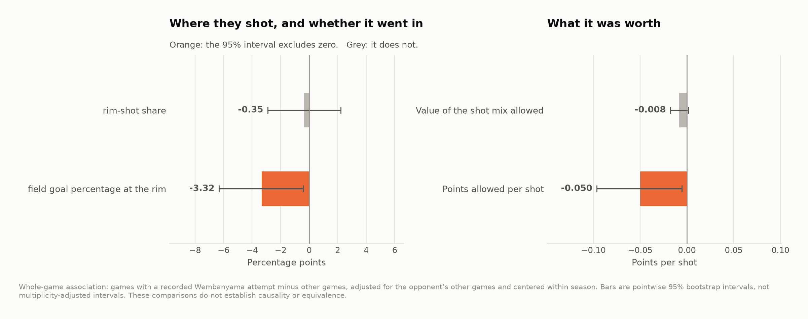
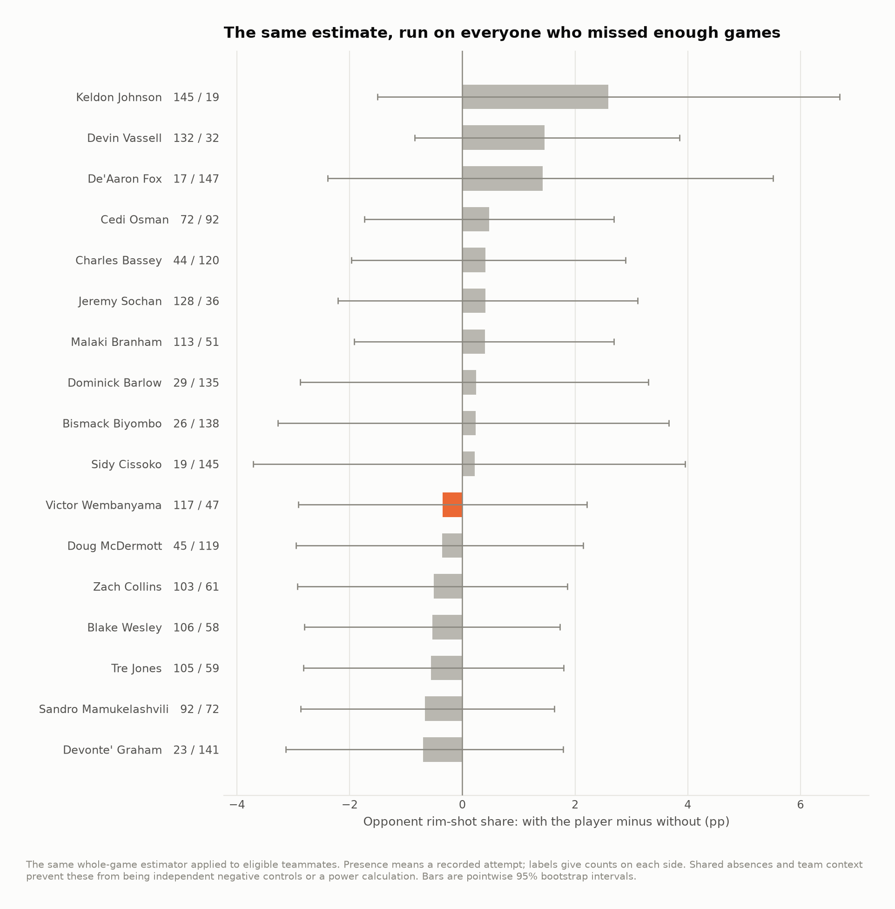
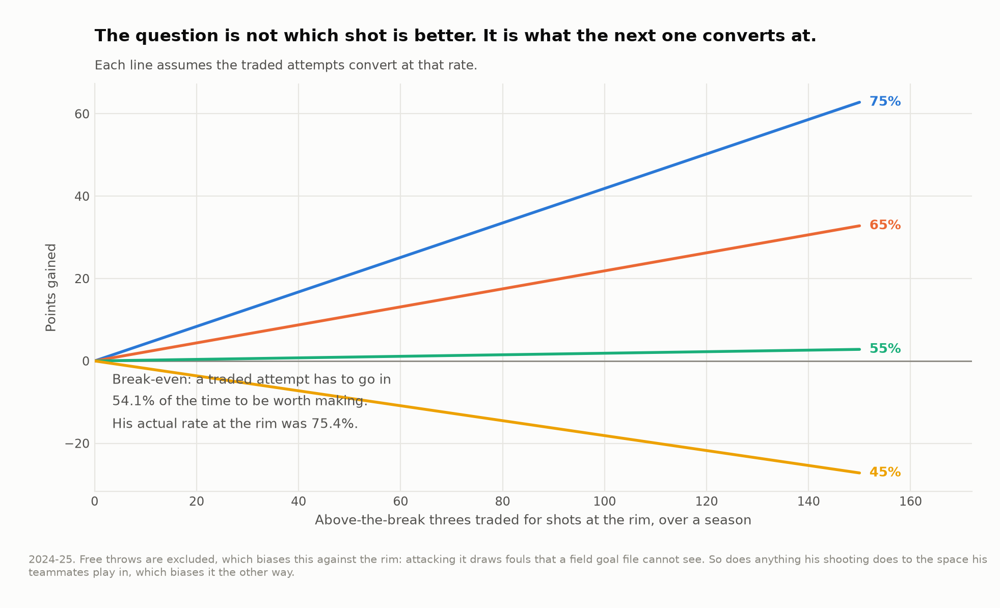

# Wembanyama availability and opponent shot profiles

Does San Antonio face a different shot profile in games where Victor Wembanyama records a field-goal attempt? This study compares his first two regular seasons, 2023–24 and 2024–25, using whole-game shot files. It addresses an availability association; it does not measure his on-court defensive effect.

Each game's opponent profile is compared with that opponent's other games in the same season. Within-season centering reduces between-season roster differences. Presence is inferred from at least one recorded attempt, so appearances without an attempt can be misclassified.

## What the comparison shows

| Label | Unit | Estimate | 95% lower | 95% upper | p-value |
|---|---|---|---|---|---|
| Opponent rim-shot share | pp | -0.354 | -2.907 | 2.214 | 0.7925 |
| Opponent field goal percentage at the rim | pp | -3.319 | -6.321 | -0.417 | 0.0270 |
| Value of the shot mix allowed | pts/shot | -0.008 | -0.018 | 0.001 | 0.0870 |
| Points allowed per shot | pts/shot | -0.050 | -0.096 | -0.005 | 0.0270 |

Source: [on_off.csv](output/on_off.csv).

The rim-share interval includes both a decrease and an increase. This analysis therefore does not establish either deterrence or its absence. A nonsignificant result is not an equivalence test, and the teammate comparison is not a power calculation.



The zone results are exploratory associations. The multiple-testing table reports the full family of twelve comparisons, including those that do not survive correction. The original rim-conversion and points-per-shot p-values alone are insufficient to claim confirmed effects after that correction.

| Label | p-value | Rank | Threshold | Survives fdr |
|---|---|---|---|---|
| Mid-Range share | 0.0005 | 1.000 | 0.004 | True |
| Corner 3 share | 0.0015 | 2.000 | 0.008 | True |
| Opponent field goal percentage at the rim | 0.0270 | 3.000 | 0.013 | False |
| Points allowed per shot | 0.0270 | 4.000 | 0.017 | False |
| Value of the shot mix allowed | 0.0870 | 5.000 | 0.021 | False |
| Corner 3 conversion | 0.3290 | 6.000 | 0.025 | False |
| Above the Break 3 conversion | 0.6200 | 7.000 | 0.029 | False |
| Mid-Range conversion | 0.7200 | 8.000 | 0.033 | False |
| In The Paint (Non-RA) conversion | 0.7865 | 9.000 | 0.037 | False |
| Opponent rim-shot share | 0.7925 | 10.000 | 0.042 | False |
| In The Paint (Non-RA) share | 0.9300 | 11.000 | 0.046 | False |
| Above the Break 3 share | 0.9690 | 12.000 | 0.050 | False |

Source: [multiple_tests.csv](output/multiple_tests.csv).



Teammates share absences, opponents and lineup changes. Applying the same estimator to them reveals sensitivity to availability patterns; it neither makes them valid negative controls nor separates Wembanyama from the surrounding roster.

## A separate offensive decision

His own shot profile supports a break-even exercise: how efficient would additional rim attempts need to be to equal the field-goal points from the threes being replaced?



This is conditional arithmetic, not an instruction to manufacture a fixed number of rim attempts. The opportunities being added may be harder than the ones already taken. Free throws, turnovers, spacing for teammates and defensive reactions are outside the calculation. The model does not estimate extra wins.

## Basketball use and next validation

The useful coaching follow-up is to review matched possessions for changes in help position and corner coverage, while separating minutes with and without the player. Whole-game shot files cannot perform that separation. The existing result can guide film questions; it cannot settle what Wembanyama causes opponents to do.

Data ends in 2024–25. This is a historical study, not a current availability report.


## Reproduce

The historical analysis used Python 3.12 with the pinned dependencies below. From this repository:

```bash
python3.12 -m venv .venv
source .venv/bin/activate
python -m pip install -r requirements.txt
make fetch-data PY=python
make all PY=python
make report site PY=python
```

`make all` verifies source hashes before running the analyses in order. A missing or changed input stops the build. Data downloads need network access; article rendering uses the included result tables. See [the source manifest](data/source_manifest.json), [method notes](docs/method.md) and [current validation record](VALIDATION_CURRENT.md) for the distinction between a source rebuild and checks of delivered outputs.

Season keys in CSV files use the **ending year**: `2025` means 2024–25. Display tables use full season labels. The MIT license covers code; third-party data retain their providers' rights and terms.

[Portfolio](https://github.com/jmsmarrelli/basketball-analytics) · [AI assistance and provenance](PROVENANCE.md)
