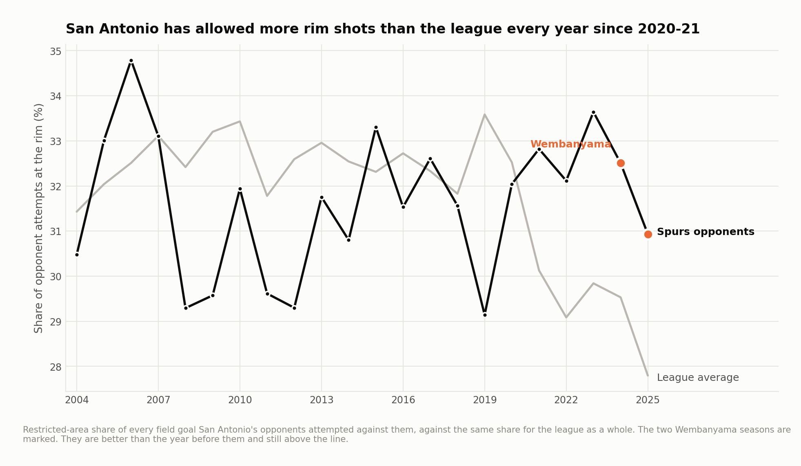
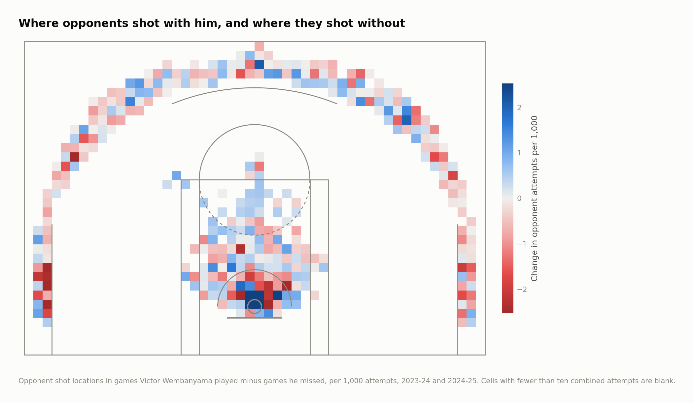
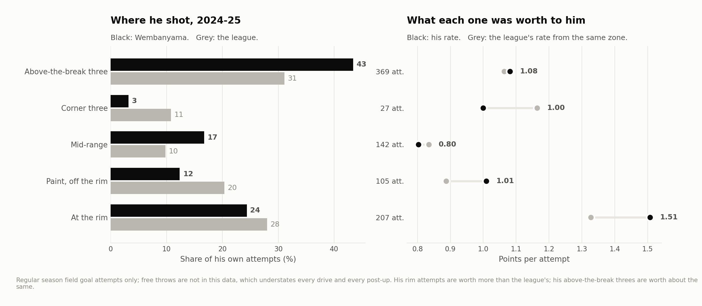
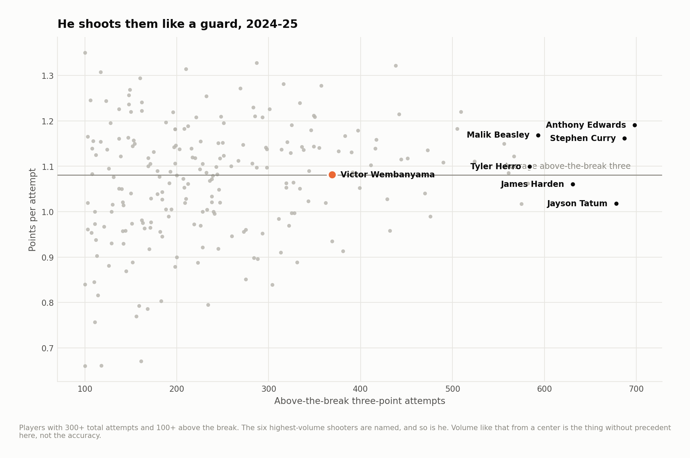

# What Wembanyama actually changes

The public shot files reach 2024-25. The play-by-play mirror the rest of these
projects read from (hoopR-data) stops at 2022-23, so this study has no lineup
data for his first two seasons and cannot build an on-court/off-court split the
usual way.

There is another way. He missed 47 of San Antonio's 164 games across his first
two seasons, and every shot either team took in all 164 is on record. That is a
game-level on/off, and with the right controls it is enough to ask a specific
question: **does the shot chart look different when he plays?**

148,626 opponent attempts and 147,888 Spurs attempts across 1,767 games,
2003-04 to 2024-25.

---

## The claim, and what the data says about it

The thing said about him more than anything else is that opponents stop going to
the rim. It is the first-order description of a 7'4" defender with an eight-foot
wingspan, and it is the one claim here that a game-level design cannot confirm.

**Opponent rim-shot share, with him minus without: −0.35 percentage points, 95%
interval −2.91 to +2.21, p = 0.79.** At the level of whole games, no detectable
change.

That is not the same as no effect, and the reason is the design. A game-level
split spreads whatever happens during his minutes across the eighteen or so
minutes a night he sits, and the comparison group is 47 games. An effect of four
or five points during his minutes would land at about −3 points over a whole
game — right at the edge of this interval. The instrument is too blunt to tell
those two stories apart. Running the identical estimator on every Spur who
missed enough games puts him **seventh of seventeen**, which says the same thing
from the other side: at this resolution his games do not look different from
anyone else's.

With lineups, the answer sharpens. A minute-level version of the same question
for 2025-26, built from reconstructed substitutions in the separate
`spurs-research` repository, puts opponents' rim share **4.6 points lower during
his minutes**, interval −7.0 to −2.3. That is the better instrument, and it is
the number to quote.


Zoom out and the same thing is visible without any model. San Antonio's opponents
have taken a larger share of their shots at the rim than the league average in
every season since 2020-21, including both of his.



---

## What does change

Four measures of the same defense, each game scored against what that opponent
shot in its *other* games that season:


| | With − without | 95% interval | p |
|---|---|---|---|
| Opponent rim-shot share | −0.35 pp | −2.91 to +2.21 | 0.79 |
| Opponent field goal % at the rim | **−3.32 pp** | −6.32 to −0.42 | 0.027 |
| Value of the shot mix allowed | −0.008 pts/shot | −0.018 to +0.001 | 0.087 |
| Points allowed per shot | **−0.050** | −0.096 to −0.005 | 0.027 |

Opponents go to the rim exactly as often and convert three points worse when they
get there. That is rim protection without deterrence — a different mechanism from
the one in the broadcast, and arguably a more valuable one, because a contested
attempt at the rim is a worse possession for the offense than a pass out to a
shooter.

But the zone breakdown is where the real finding is, and it is not about the rim
at all:

| Zone | Change in share | 95% interval |
|---|---|---|
| At the rim | −0.35 pp | −2.91 to +2.21 |
| Paint, off the rim | +0.10 pp | −2.18 to +2.25 |
| **Mid-range** | **+2.15 pp** | +1.05 to +3.28 |
| **Corner three** | **−1.89 pp** | −3.13 to −0.69 |
| Above-the-break three | −0.00 pp | −1.72 to +1.72 |

With him on the floor, opponents take fewer corner threes and more mid-range
shots. Those are the two ends of the shot-value scale — a corner three is worth
1.16 points across this data and a mid-range shot 0.80 — and the trade runs in
San Antonio's favor on every attempt it happens.



**Twelve distinct tests were run on one player** — two summary measures plus a
share and a conversion rate in each of five zones — so the whole family goes
through a Benjamini–Hochberg pass at 5%. Four of the twelve cleared 0.05 on
their own. Two survive the correction: mid-range share (p = 0.0005) and
corner-three share (p = 0.0015). The rim conversion effect and points allowed
per shot, both at p = 0.027, do not. `output/multiple_tests.csv` has the full
table, including the results that did not make it.

So the defensible version of what *this* data shows is narrow: the one thing that
reliably moves in the games Wembanyama plays is where opponents shoot from
*outside* the paint. The rim numbers point the right way and a game-level split
is not strong enough to claim them.

---

## The other argument

In 2024-25 he attempted **369 above-the-break threes and 207 shots at the rim**.
Above the break was 43% of his shot diet against a league rate of 31%; the rim
was 24% against 28%. In his rookie season those numbers were 31% and 33%.



His rim attempts were worth **1.51 points each**, against a league average of
1.33 from the same zone. His above-the-break threes were worth **1.08**, against
a league average of 1.06 — which ranks him **115th of 223** qualified shooters,
and **35th in volume**.



The obvious conclusion is that he should trade threes for rim attempts, and the
obvious conclusion is answering a question the arithmetic does not pose. His 1.51
describes the rim attempts a defense *gave* him. The ones he would manufacture by
declining an open look are, by construction, the ones a defense chose not to give
up, and no shot file says what those are worth.

What the file can do is price the decision:


**Break-even is 54.1%.** A traded attempt has to go in more than 54.1% of the
time to be worth making — against his actual rim rate of 75.4%, and against the
league's 2024-25 restricted-area rate of 66%. Trading 150 above-the-break threes for rim attempts
over a season is worth +63 points if those attempts convert like his current
ones, +33 at 65%, +3 at 55%, and −27 at 45%.

Two things bias that in opposite directions and neither is in the data. Free
throws are absent, which undersells every attempt at the rim, because attacking
it draws fouls. And whatever his shooting does to the floor his teammates play on
does not show up on his own line at all. The honest summary is that the trade is
favorable across most plausible assumptions and the margin is a win or two, not
a transformation.

---

## Why the controls are the project

Three of them do most of the work, and the estimate is meaningless without any
one.

**Every game is scored against the opponent's own baseline.** Not the league
average — what that specific opponent shot in its *other* games that season.
Denver goes to the rim more than Boston; a schedule is not a random draw; and the
games a player misses are not a random draw from the schedule. Differencing
against the opponent's own year removes all three at once.

**Every comparison is inside a season.** Without it, a player who arrived for one
of the two years gets handed the difference between two rosters as his personal
effect. Chris Paul played 82 games for San Antonio and missed 82; both numbers
are one whole season, and his uncorrected "on/off" is just 2024-25 minus 2023-24.
Centering within season sends that to zero, where it belongs.

**Everyone gets the same estimator.** The placebo panel is not a courtesy. An
on/off design cannot separate one player from everything else that changed while
he sat, and the only way to find out whether it is measuring a player or a season
is to run it on people whose presence should not matter.

---

## What this cannot do

- **Blocks, fouls, turnovers and rebounds are all invisible.** This is a field
  goal file. A defender who ends possessions without a shot attempt is
  undercounted by exactly the amount he is good at it.
- **Presence is inferred from attempts.** No minutes column exists, so a player
  counts as available in a game if he took a shot in it. For a rotation player
  that misses a game or two a year.
- **It is a team effect measured in his presence.** He and Jeremy Sochan and Zach
  Collins missed overlapping stretches, and no game-level design can pull them
  apart. The placebo panel bounds how much of the estimate the roster explains;
  it does not eliminate it.
- **Two seasons, 164 games.** The intervals are wide because the sample is small,
  and they are reported wide rather than narrowed by a choice of test.
- **Regular season only.**

---

## Running it

```bash
pip install -r requirements.txt
python src/run_01_build.py       # raw shot files -> Spurs games and opponent baselines
python src/run_02_deterrence.py  # the on/off design, figures 01-04
python src/run_03_offense.py     # his own shot diet and the trade, figures 05-07
```

Or `make all`. Under a minute end to end.

```
src/
  config.py        paths, seasons, the sample floors
  features.py      raw rows -> features, coordinate repair, heave filter
  deterrence.py    the estimator: baselines, centring, weighting, bootstrap
  court.py         half-court drawing in the data's own coordinates
  labels.py        collision-resolving point labels
  style.py         one place that decides what every figure looks like
  run_0*.py        the pipeline, in order
output/            every number quoted above, as CSV
figures/           seven figures, regenerated from scratch by the pipeline
docs/method.md     longer notes, including what did not work
```

## Data

Shot-level files from [DomSamangy/NBA_Shots_04_24](https://github.com/DomSamangy/NBA_Shots_04_24),
which packages the NBA's public shot chart endpoint by season. `data/README.md`
has the fetch step.

Three of the twenty-two season files are published on a different coordinate
scale from the other nineteen. `features.normalise_coordinates` detects and
inverts it, and `output/build_audit.csv` records which seasons were repaired.

## License

MIT. See `LICENSE`.
